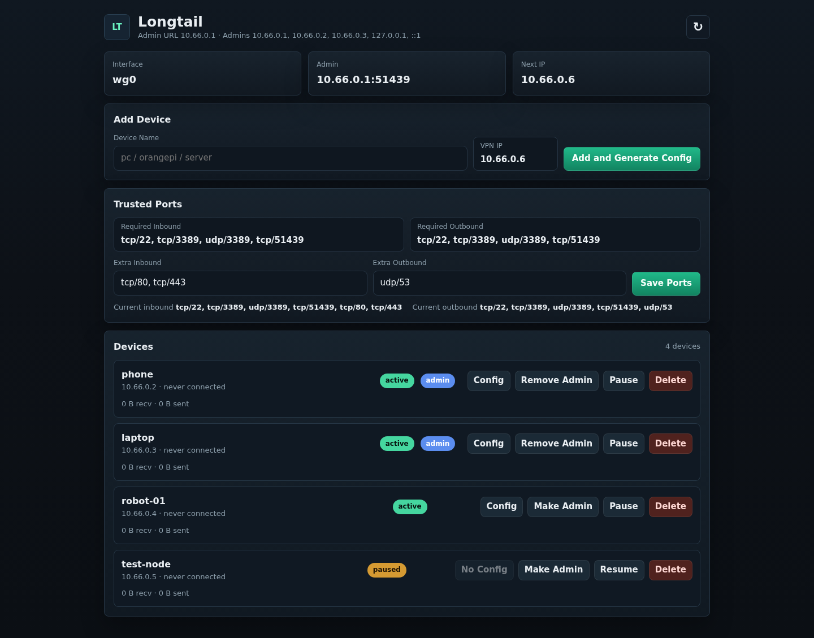

# PeerHarbor — WireGuard VPN & Ubuntu Remote Desktop

English | [中文](README.zh-CN.md)

**Connect your machines. Open your existing Ubuntu desktop in a browser.**

PeerHarbor combines a **self-hosted WireGuard VPN web manager** with an independent
**browser remote desktop** for Ubuntu/Linux Xorg sessions. Add VPN devices with
QR codes, manage peers and trusted ports, then use SSH and your browser to work
on the desktop that is already running on your remote computer.

[Install the VPN manager](#install-peerharbor) · [Start the remote desktop](#run-remotedesktop) ·
[Tailscale, NoMachine and RDP](#tailscale-nomachine-and-rdp) · [中文说明](README.zh-CN.md)



*WireGuard manager screenshot from the earlier Longtail release. Follow the installation output for your actual
admin address and port.*

## What you can do

- **Let an AI agent prepare deployment:** inspect prerequisites and installation plans as JSON, then run the unified installer.
- **Manage a private network from the browser:** add devices, scan WireGuard QR
  codes, download client configurations, pause/resume peers and manage admin access.
- **Reach your own computers:** use standard WireGuard clients with a server
  endpoint you operate, and configure trusted ports for services such as SSH or RDP.
- **Share the desktop already on screen:** view and control an active Ubuntu Xorg
  session through noVNC and x11vnc, including view-only and fullscreen modes.
- **Choose either tool or both:** use the VPN manager on its own, use RemoteDesktop
  over an existing LAN, or connect to a WireGuard address through an SSH tunnel.

Useful for a home lab, a personal workstation or a small group of Linux machines
where you want to manage the network and access an existing graphical session.

## Quick start and AI installation

On an Ubuntu/Debian host with Python 3 and Git:

```bash
git clone https://github.com/equationofmathphysics/peerharbor.git
cd peerharbor
```

**VPN server:** replace the example endpoint with your reachable server address.

```bash
python3 peerharbor.py doctor vpn
python3 peerharbor.py plan vpn --endpoint vpn.example.com:51820
python3 peerharbor.py install vpn --endpoint vpn.example.com:51820 --peer phone
```

**Ubuntu desktop:** run as the desktop user in an active Xorg graphical terminal.

```bash
python3 peerharbor.py doctor desktop
python3 peerharbor.py install desktop
./remotedesktop/start.sh
```

The installer uses sudo for system packages; it may prompt for your existing sudo
password. Desktop setup creates the user virtualenv and validates the session;
`start.sh` starts sharing. VPN setup configures WireGuard and starts its services.
For existing VPN installations, review the plan before using `--reuse-existing`:
the existing key is reused, while the managed environment settings are updated.

**For AI agents:** `doctor` and `plan` support `--json` and make no system changes.
Use [the AI installation guide](docs/AI_INSTALL.md) or [llms.txt](llms.txt).
They describe required inputs, exit codes, validation and connection handoff.

```text
Install PeerHarbor's VPN manager on my server. The endpoint is <host>:51820.
Read docs/AI_INSTALL.md, run doctor and plan with --json, then install and verify.
Report the admin URL and connection steps; keep private keys and QR codes local.
```

## Two tools, one remote-access workflow

| Tool | What it does | Documentation |
| --- | --- | --- |
| [PeerHarbor VPN manager](longtail/) | WireGuard network, peer and trusted-port management through a web admin panel | [English](longtail/README.md) · [中文](longtail/README.zh-CN.md) |
| [PeerHarbor RemoteDesktop](remotedesktop/) | Browser-based viewing and control of an already logged-in Xorg desktop | [English](remotedesktop/README.md) · [中文](remotedesktop/README.zh-CN.md) |

```text
Your computer ── WireGuard network (optional on an existing LAN) ── Ubuntu host
Your browser ── local SSH tunnel ── RemoteDesktop gateway ── existing Xorg desktop
```

The two applications run independently and have separate authentication and web
processes. RemoteDesktop binds to localhost; access from another computer uses
an SSH tunnel. VPN membership does not replace SSH or desktop authentication.

## Tailscale, NoMachine and RDP

If you found PeerHarbor while looking for a Tailscale alternative, a NoMachine
alternative or Ubuntu remote desktop / RDP access, choose by the workflow you need:

| Your goal | How PeerHarbor fits | Current boundary |
| --- | --- | --- |
| Self-hosted private networking instead of a Tailscale workflow | Operate a WireGuard server and manage standard WireGuard peers from a web UI. | Uses its own WireGuard configurations; it does not implement the Tailscale control plane, client enrollment or automatic mesh/relay system. A reachable server endpoint is required. |
| Access an existing Ubuntu desktop when considering NoMachine | Open the current Xorg session in a browser using noVNC/x11vnc through SSH. | Does not implement the NoMachine/NX protocol; no performance or feature-parity claim. |
| Connect an existing RDP client to an RDP server over a private network | Use the WireGuard network as transport and configure the required trusted ports. | Bring your own RDP server and client. The included browser desktop speaks VNC/RFB, not RDP. |
| Linux desktop sharing in a browser | Use the included RemoteDesktop application, validated on Ubuntu 24.04 with Xorg. | Requires an active, already logged-in graphical session; Wayland and the login screen are outside the current scope. |

RemoteDesktop currently supports one controller at a time. Clipboard, file
transfer, remote resolution changes, unattended boot/login and direct public
HTTPS/WSS hosting are outside its current scope. See the
[full requirements and limitations](remotedesktop/README.md#requirements).

## Why I built PeerHarbor

I built this project for my own LAN management and remote desktop needs. I wanted
to avoid the cost of NoMachine's paid offerings, and Tailscale did not feel
convenient for my workflow. That led to tools I could deploy and manage myself,
shared here for others with similar needs to use and improve.

## Install PeerHarbor

```bash
sudo apt update
sudo apt install -y git
sudo git clone https://github.com/equationofmathphysics/peerharbor.git /opt/longtail
cd /opt/longtail/longtail
sudo ./deploy/bootstrap.sh YOUR_SERVER_IP_OR_DOMAIN:51820 phone
```

The installer manages WireGuard and the `longtail-web` service. Read the
[PeerHarbor documentation](longtail/README.md) before deploying to a server.

## Run RemoteDesktop

Run this as the desktop user, inside an active Ubuntu Xorg graphical session:

```bash
sudo apt install -y python3-venv x11vnc x11-utils
cd /path/to/longtail/remotedesktop
/usr/bin/python3 -m venv .venv
.venv/bin/python -m pip install -r requirements.txt
./start.sh
```

Open `http://127.0.0.1:8765/`. The username is `demo`; a random access password is
printed in the terminal each time the service starts. The included frontend is
already built, so Node.js is only needed when changing frontend code.

For another computer on the LAN or WireGuard network:

```bash
ssh -N -L 127.0.0.1:8765:127.0.0.1:8765 desktop-user@desktop-host
```

Keep the tunnel running and open `http://127.0.0.1:8765/` on that computer.
See [RemoteDesktop usage and limitations](remotedesktop/README.md).

## Existing Longtail / PeerHarbor installations

PeerHarbor was previously named Longtail. The `longtail/` directory,
`longtail-web` service and `/etc/longtail` / `/var/lib/longtail` paths retain their
legacy names so existing installations remain compatible.

The original application moved from the repository root into `longtail/`.
Existing `/etc/longtail`, `/etc/wireguard`, and `/var/lib/longtail` data paths
have not changed. An installation using the old root-level virtualenv/service
paths needs a one-time service-path update after pulling this change:

```bash
cd /opt/longtail
sudo git pull --ff-only
cd longtail
sudo /usr/bin/python3 -m venv .venv
sudo .venv/bin/python -m pip install -r requirements.txt
sudo install -m 644 deploy/longtail-web.service /etc/systemd/system/longtail-web.service
sudo systemctl daemon-reload
sudo systemctl restart longtail-web
```

These paths assume the checkout is `/opt/longtail`. For a different checkout,
adjust `WorkingDirectory` and `ExecStart` in the service before installing it.
Do not move or overwrite existing WireGuard configurations or keys.

## License

Project-authored code retains the repository's existing
[WH Covenant Public License](LICENSE). Third-party components retain their own
licenses; see [RemoteDesktop third-party notices](remotedesktop/THIRD_PARTY_NOTICES.md).
